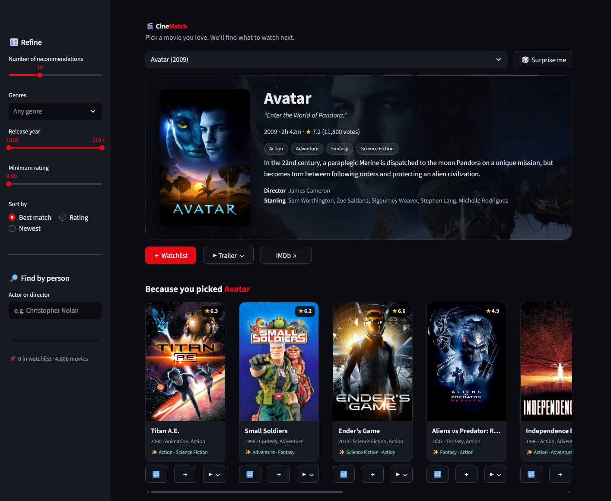

# 🎬 CineMatch: Movie Recommender


A content-based movie recommender built on the **TMDB 5000** dataset, with a dark, Netflix-style Streamlit UI.
Pick a movie you love and CineMatch finds what to watch next, based on plot, genres, keywords, cast and director.



## ✨ Features

- **Smart recommendations:** similar movies, each with a short reason it was picked
  (*🎬 Also directed by James Cameron*, *🎭 Also stars Tom Hanks*, *✨ Action · Sci-Fi*)
- **Netflix-style rows** you scroll sideways
  - Because you picked *[movie]*
  - More from *[director]*
  - Top-rated *[genre]*
  - 🔥 Trending this week (live from TMDB)
  - ⭐ All-time top rated
  - 📌 My watchlist
- **Hero banner:** backdrop, poster, tagline, rating, runtime, genres, overview, director and cast
- **In-app trailers** (YouTube) and IMDb links
- **Sidebar filters:** number of results, genres, release year, minimum rating, and sorting by match, rating or newest
- **Find by person:** search by actor or director
- **🎲 Surprise me:** jump to a random highly rated movie (honours your genre filter)
- **Watchlist:** save movies with ＋ as you browse
- **Fast and light:** loads under 5 MB of data, and API calls are cached and run in parallel

## 🚀 Run locally

```bash
git clone https://github.com/Saurabh-2342/movie-recommender.git
cd movie-recommender

python -m venv venv
venv\Scripts\activate            # macOS/Linux: source venv/bin/activate
pip install -r requirements.txt
```

Get a free **API Read Access Token** from [TMDB](https://www.themoviedb.org/settings/api) and put it in `.streamlit/secrets.toml`:

```toml
TMDB_TOKEN = "your-token-here"
```

You can also set it as an environment variable named `TMDB_TOKEN`. Then start the app:

```bash
streamlit run app.py
```

The app opens at <http://localhost:8501>. Without a token it still recommends movies, just without posters, trailers or the trending row.

## ☁️ Deploy (Streamlit Community Cloud)

1. Fork or push this repo to GitHub.
2. Go to [share.streamlit.io](https://share.streamlit.io) and choose **New app**. Pick this repo, set the branch to `main` and the main file to `app.py`.
3. Under **Advanced settings → Secrets**, add `TMDB_TOKEN = "your-token-here"`.
4. Click **Deploy**.

## 🧠 How it works

1. **Feature engineering** (`Movie_recomender.ipynb`)
   - Merges `tmdb_5000_movies.csv` with `tmdb_5000_credits.csv`
   - Builds a *tag* string for each movie from its overview, genres, keywords, top 3 cast and director
   - Vectorizes the tags with `CountVectorizer` (bag of words, top 5,000 terms, English stop words removed)
2. **Similarity:** cosine similarity between every pair of movies gives a 4,806 × 4,806 matrix (~185 MB).
3. **Compaction** (`build_artifacts.py`)
   - Keeps only each movie's **top 50 neighbours** in `neighbors.npz` (~0.7 MB, about 250× smaller)
   - Builds `movies_meta.pkl`, which holds the genres, year, rating, runtime, overview, cast and director the UI needs
4. **App** (`app.py`)
   - Looks up neighbours instantly and applies your filters
   - Fetches posters, backdrops and trailers from the TMDB API in parallel and caches them

To rebuild the artifacts, run the notebook to regenerate `similarity.pkl`, then run:

```bash
python build_artifacts.py
```

## 📁 Project structure

```
movie-recommender/
├── app.py                    # Streamlit app (UI + recommendation logic)
├── build_artifacts.py        # Shrinks similarity matrix → neighbors.npz, builds movies_meta.pkl
├── Movie_recomender.ipynb    # EDA, feature engineering, similarity computation
├── neighbors.npz             # Top-50 similar movies per movie (used by the app)
├── movies_meta.pkl           # Movie metadata for display & filtering (used by the app)
├── movie_list.pkl            # Movie ids/titles/tags from the notebook
├── movie_dict.pkl
├── tmdb_5000_movies.csv      # Raw dataset
├── tmdb_5000_credits.csv
├── requirements.txt
├── .streamlit/
│   ├── config.toml           # Dark theme
│   └── secrets.toml          # Your TMDB token (git-ignored, create it yourself)
└── docs/screenshot.jpg
```

## 🛠️ Tech stack

- **Python**, **pandas**, **NumPy**
- **scikit-learn**, used in the notebook for `CountVectorizer` and cosine similarity
- **Streamlit** for the UI, with custom CSS
- **TMDB API** for posters, backdrops, trailers and trending movies

## 🙏 Credits

- Dataset: [TMDB 5000 Movie Dataset](https://www.kaggle.com/datasets/tmdb/tmdb-movie-metadata) on Kaggle
- Posters, backdrops, trailers and trending data come from [The Movie Database (TMDB)](https://www.themoviedb.org/)

 *This product uses the TMDB API but is not endorsed or certified by TMDB.*
